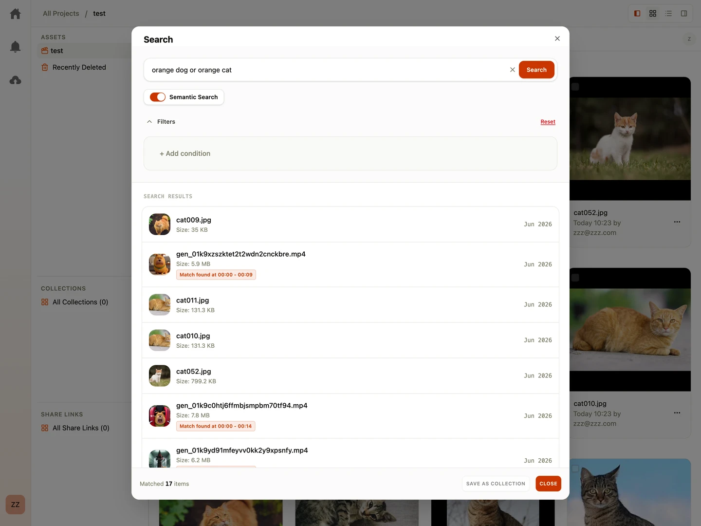

Traditional search relies on matching exact characters (e.g., searching "dog" will not find files named "golden_retriever.jpg"). Shumai resolves this with **Semantic Search**, which indexes the conceptual meaning of your files.

---

## How Semantic Search Works

Semantic search translates text queries and file contents into conceptual profiles. Similar ideas and visuals are mapped near each other.

1.  **Index Generation**: When you upload an asset, Shumai's background agent scans the file's visual elements, text contents, or descriptions, translating them into a concept profile.
    - **Multimodal Embedding Providers**: Shumai supports two embedding providers:
      - **EmbeddingGemma 2 (Local)**: Powered by `shumaiOne/embedding-server` with 768-dimensional multimodal vectors running completely offline. Videos are sampled at **15 frames per minute** (14 frames for non-standard aspect ratios) per 60-second chunk. See the [Embedding Server Setup Guide](./embedding-server) for full details.
      - **Gemini Embedding 2 (Cloud)**: Powered by Google's `gemini-embedding-2` API with 1536-dimensional vectors. Videos are chunked into 60-second segments (sampled up to 32 frames per chunk at 1 fps with audio stripped).
    - **Chunking Configuration**: Administrators can customize chunk duration and overlap using the `EMBEDDING_CHUNK_DURATION` (default: 60s) and `EMBEDDING_CHUNK_OVERLAP` (default: 5s) environment variables.
2.  **Concept Matching**: When you search with the "Semantic" toggle enabled, Shumai matches the conceptual meaning of your query against your assets.
3.  **Result**: Searching "sunset at the beach" will successfully find a video file of ocean waves at dusk, even if the filename is `IMG_4029.mp4`.

### Understanding Search Results

Semantic search works differently than traditional keyword filtering:

- **Sort vs. Filter**: Semantic search acts more like a **sort** than a strict filter. While the most relevant results will appear at the top, less related content may still be present further down the list, ranked lower. If you need to exclude specific types of files, use the **Filter** panel in conjunction with semantic search.
- **Video Chunks**: Because Shumai indexes videos in chunks, a single long video may appear multiple times in your search results. Each result corresponds to a specific segment of the video where the match was found.
- **Match Timestamps**: When a search result comes from a video chunk, Shumai displays the matching start and end time. Clicking on these results will open the video and automatically jump to the relevant timestamp.

---

## Activating Semantic Search

To use semantic search:

1.  Verify that your administrator has enabled the **Embedding Agent** under **Team Settings** > **Agents**.
2.  Once active, Shumai will automatically begin indexing new uploads.
3.  Toggle the **Semantic** button next to the search input in the file explorer to search by conceptual meaning.

