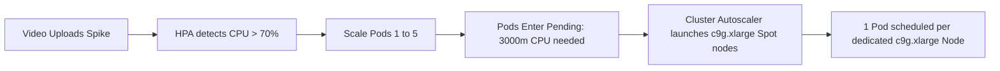

# Shumai on AWS EKS with Graviton5 Spot & Autoscaling

This directory contains a complete, production-ready Kubernetes deployment example demonstrating how to run Shumai on **Amazon Elastic Kubernetes Service (AWS EKS)** with horizontal autoscaling for compute-heavy media processing.

---

## Architecture Overview

```text
                                [ User / Internet ]
                                         │
                    ┌────────────────────┴────────────────────┐
                    │ (Port 80/3000)                          │ (Port 3900)
                    ▼                                         ▼
        ┌───────────────────────┐                 ┌───────────────────────┐
        │  shumai-server (ELB)  │                 │  garage-public (ELB)  │
        └───────────┬───────────┘                 └───────────┬───────────┘
                    │                                         │ Direct Browser Uploads
                    │                                         ▼ (Presigned URLs)
┌───────────────────┼─────────────────────────────────────────────────────────────────┐
│ General Workload Node (c9g.large Spot, ~$0.03/hr)                                   │
│                   │                                                                 │
│                   ▼                                                                 │
│       ┌───────────────────────┐    DBOS Tasks    ┌───────────────────────────┐      │
│       │     shumai-server     ├─────────────────►│      shumai-postgres      │      │
│       │ (SHUMAI_WORKERS=agent)│ (transcode_queue)│      (pgvector:pg18)      │      │
│       └───────────┬───────────┘                  └─────────────┬─────────────┘      │
│                   │                                            │                    │
│                   │                                            │ Task Polling       │
│                   ▼                                            ▼                    │
│       ┌───────────────────────┐                  ┌───────────────────────────┐      │
│       │       garage-s3       │◄─────────────────┤     shumai-transcode      │      │
│       │    (dxflrs/garage)    │ Fetch Source /   │     (Worker Pod 1)        │      │
│       └───────────────────────┘ Write Proxies    └───────────────────────────┘      │
└────────────────────────────────────────────────────────────────┬────────────────────┘
                                                                 │ HPA Target: 70% CPU
                                                                 ▼
┌─────────────────────────────────────────────────────────────────────────────────────┐
│ Transcode Compute Pool (c9g.xlarge Graviton5 Spot, ~$0.08/hr, 1 Pod per Node)       │
│                                                                                     │
│  ┌──────────────────────────┐  ┌──────────────────────────┐  ┌────────────────────┐ │
│  │     shumai-transcode     │  │     shumai-transcode     │  │  shumai-transcode  │ │
│  │      (Worker Pod 2)      │  │      (Worker Pod 3)      │  │   (Worker Pod N)   │ │
│  └──────────────────────────┘  └──────────────────────────┘  └────────────────────┘ │
│           ▲                              ▲                             ▲            │
│           │                              │                             │            │
│  ┌────────┴─────────────────┐  ┌─────────┴────────────────┐  ┌─────────┴──────────┐ │
│  │ Node: c9g.xlarge (Spot)  │  │ Node: c9g.xlarge (Spot)  │  │Node: c9g.xlarge    │ │
│  └──────────────────────────┘  └──────────────────────────┘  └────────────────────┘ │
│                                                                                     │
│        Cluster Autoscaler: Dynamically provisions / terminates c9g.xlarge nodes     │
└─────────────────────────────────────────────────────────────────────────────────────┘
```

---

## Core Design Principles

### 1. Compute Tiering & Why Graviton5 (`c9g.xlarge`)

Media transcoding with FFmpeg is one of the most CPU-intensive workloads in modern web applications. To achieve maximum throughput at minimum cost, this deployment separates system services from media encoding:

- **General System Node (`shumai-general-spot`)**: A single 2 vCPU / 4 GiB RAM (`c9g.large` Spot) node (~$0.03/hr) runs the Web UI, API, PostgreSQL, and Garage S3.
- **Dedicated Transcode Pool (`shumai-transcode-spot`)**: High-performance 4 vCPU / 8 GiB RAM (`c9g.xlarge` Spot) instances dedicated exclusively to media encoding.

**Why choose AWS Graviton5 (`c9g.xlarge`)?**
AWS Graviton5 is AWS's fifth-generation custom ARM64 processor, built on the 6th-generation Nitro system with sustained 3.3 GHz clock speeds, high-speed DDR5 memory (8800 MT/s), and 5x more L3 cache. As demonstrated in AWS's video encoding benchmarks (see [Optimized Video Encoding with FFmpeg on AWS Graviton Processors](https://aws.amazon.com/cn/blogs/opensource/optimized-video-encoding-with-ffmpeg-on-aws-graviton-processors/)), Graviton processors deliver exceptional performance and frames-per-second per dollar for media workloads. Graviton5 further pushes compute performance by up to 25% per vCPU. Coupled with AWS EC2 Spot instances, `c9g.xlarge` costs only **~$0.08/hour** (a massive discount over On-Demand).

### 2. In-Cluster S3 vs. Native Amazon S3

> [!NOTE]
> **Why Garage is included in this example**:
> We include **Garage S3** (`dxflrs/garage`) on EBS gp3 to demonstrate a **100% self-contained, fully self-hosted deployment** that boots without requiring an external cloud storage account or pre-existing S3 buckets.

> [!TIP]
> **Production Recommendation**:
> If you are deploying on AWS, you should consider using **native Amazon S3 directly** (e.g. by setting `S3_BUCKET: my-prod-bucket`). Real Amazon S3 provides virtually infinite capacity, 11 9s durability, global availability, and eliminates the operational overhead of managing in-cluster storage volumes.

When running Garage in-cluster, Shumai utilizes **Split-Horizon S3 Resolution**:
- **Internal Traffic (`AWS_ENDPOINT_URL_S3`)**: Points to `http://garage.shumai.svc.cluster.local:3900`. Backend server and worker pods stream source files and upload transcoded HLS chunks over private cluster networking with **zero AWS data transfer fees** and microsecond latency.
- **Public Client Traffic (`AWS_PUBLIC_ENDPOINT_URL_S3`)**: Points to the public LoadBalancer (`http://<garage-public-elb>:3900`) for generating presigned upload/download URLs so end-user browsers can stream and upload files directly.

### 3. Task Orchestration via DBOS Transact

All video and document transcoding jobs are enqueued to `transcode_queue` inside PostgreSQL via **DBOS Transact**. Transcode workers are completely stateless and consume jobs from the queue. Each worker pod uses the Kubernetes Downward API (`POD_NAME`) to obtain a unique, collision-free executor ID.

---

## Autoscaling Mechanics

Autoscaling operates across two coordinated layers:



1. **Horizontal Pod Autoscaler (HPA)**:
   - Configured in [`shumai-transcode-hpa.yaml`](./shumai-transcode-hpa.yaml) targeting **70% CPU utilization** of the pod's `3000m` CPU request (= 2.1 vCPUs).
   - When a video transcode starts, FFmpeg consumes ~3.5 cores, immediately exceeding 70% and prompting HPA to scale out worker pods (up to 5 replicas).
2. **1:1 Dedicated Pod-to-Node Allocation**:
   - In [`shumai-transcode.yaml`](./shumai-transcode.yaml), worker pods request `cpu: 3000m` and `memory: 4Gi` with limits at `cpu: 3900m` and `memory: 6Gi`.
   - Because a `c9g.xlarge` instance has `3920m` allocatable CPU, **strictly 1 transcode pod can fit per node**, giving FFmpeg unrestricted access to all 4 physical cores without CPU throttling.
   - Additional pods enter `Pending` state, which immediately triggers the **Kubernetes Cluster Autoscaler** to scale up the AWS Auto Scaling Group (`shumai-transcode-spot`).
3. **Graceful Scale-Down & Task Safety**:
   - **5-Minute HPA Stabilization Window** (`stabilizationWindowSeconds: 300`): Once the queue is clear and CPU drops to 0%, HPA holds replicas for 5 minutes to avoid pod thrashing if new uploads arrive.
   - **5-Minute Termination Grace Period** (`terminationGracePeriodSeconds: 300`): When Kubernetes terminates a worker, it sends `SIGTERM`. The worker stops taking new jobs, drains the active FFmpeg transcode step, uploads proxies to S3, and exits cleanly.
   - **10-Minute Node Cooldown**: Cluster Autoscaler waits for idle nodes to be unneeded for 10 minutes (`scale-down-unneeded-time=10m`) before cordoning, draining, and terminating the EC2 Spot instance.

---

## Step-by-Step Deployment Guide

### Prerequisites

- [AWS CLI](https://aws.amazon.com/cli/) installed and configured (`aws configure`).
- [`eksctl`](https://eksctl.io/) installed.
- [`kubectl`](https://kubernetes.io/docs/tasks/tools/) installed.

### Step 1: Provision the EKS Cluster

Create the cluster using the declarative [`eks/eks-cluster.yaml`](./eks-cluster.yaml) configuration:

```bash
eksctl create cluster -f eks/eks-cluster.yaml
```

This provisions:
- An EKS 1.31 control plane in a dedicated VPC across multiple AZs.
- `shumai-general-spot`: 1x `c9g.large` Spot instance (labeled `workload: general`).
- `shumai-transcode-spot`: Autoscaling `c9g.xlarge` Spot instances (min: 1, max: 5, labeled `workload: transcode`).
- AWS EBS CSI Driver with IAM OIDC roles.

### Step 2: Deploy the Shumai Stack

Deploy all components with Kustomize:

```bash
kubectl apply -k eks/
```

Verify that all initial pods reach `Running` state:

```bash
kubectl get pods -n shumai -o wide
```

### Step 3: Configure Public Access & S3 Endpoint

Retrieve the external LoadBalancer hostnames created by AWS:

```bash
kubectl get svc -n shumai
```

```text
NAME             TYPE           EXTERNAL-IP                                PORT(S)
shumai-server    LoadBalancer   k8s-shumai-xxx.us-east-1.elb.amazonaws.com 80:31234/TCP,3000:31235/TCP
garage-public    LoadBalancer   k8s-garage-xxx.us-east-1.elb.amazonaws.com 3900:31236/TCP
```

#### Option A: Quick Testing (Automated 1-Liner)
Inject the public Garage ELB hostname into `shumai-server`:

```bash
GARAGE_ELB=$(kubectl get svc garage-public -n shumai -o jsonpath='{.status.loadBalancer.ingress[0].hostname}')
kubectl set env deployment/shumai-server -n shumai AWS_PUBLIC_ENDPOINT_URL_S3="http://${GARAGE_ELB}:3900"
```

#### Option B: Production with Custom Domains
In production, point DNS records (e.g. Route 53) to your load balancers:
- Web App: `https://shumai.mycompany.com`
- S3 Storage: `https://s3.mycompany.com`

Set `AWS_PUBLIC_ENDPOINT_URL_S3: https://s3.mycompany.com` in [`eks/config.yaml`](./config.yaml) and apply once.

#### Option C: Native Amazon S3
If using real AWS S3, set `STORAGE_BACKEND: s3`, provide `S3_BUCKET`, and omit `AWS_PUBLIC_ENDPOINT_URL_S3` (native AWS S3 endpoints resolve globally).

### Step 4: Deploy Kubernetes Cluster Autoscaler

Deploy the official Cluster Autoscaler to enable automated node provisioning:

```bash
curl -s https://raw.githubusercontent.com/kubernetes/autoscaler/master/cluster-autoscaler/cloudprovider/aws/examples/cluster-autoscaler-autodiscover.yaml \
  | sed 's/<YOUR CLUSTER NAME>/shumai-eks/g' \
  | kubectl apply -f -

# Pin autoscaler to the general workload node
kubectl patch deployment cluster-autoscaler -n kube-system -p '{"spec":{"template":{"spec":{"nodeSelector":{"workload":"general"}}}}}'
```

### Step 5: Test Horizontal Autoscaling

1. Open `http://<shumai-server-elb>` in your browser and log in with your credentials.
2. Upload a batch of 10–20 video files simultaneously.
3. Watch the workers scale up horizontally:
   ```bash
   kubectl get hpa -n shumai -w
   kubectl get pods -n shumai -l app=shumai-transcode -o wide
   kubectl get nodes -L node.kubernetes.io/instance-type,workload
   ```
4. Observe that each worker consumes ~3 vCPUs on its dedicated `c9g.xlarge` instance.
5. Once all jobs complete, observe HPA scaling back down to 1 pod and Cluster Autoscaler terminating idle EC2 Spot instances.

### Step 6: Cluster Teardown & Cost Cleanup

When you are finished testing, delete all resources to prevent ongoing cloud charges:

```bash
# 1. Delete Kubernetes namespace to release ELB load balancers and EBS volumes
kubectl delete namespace shumai

# 2. Delete the EKS cluster and CloudFormation stacks
eksctl delete cluster -f eks/eks-cluster.yaml --wait
```

---

## Portability to Generic Kubernetes

While this directory is configured for AWS EKS, the exact same architecture applies directly to any Kubernetes environment:

- **Google Kubernetes Engine (GKE)**: Use `tau T2A` ARM64 instances for transcode workers and standard persistent disks (`pd-balanced`).
- **Azure Kubernetes Service (AKS)**: Use `Dpsv5` ARM64 Spot node pools.
- **Local (Minikube / Docker Desktop / Kind)**: Use the same manifests without node selectors or Cluster Autoscaler. Access services via `kubectl port-forward`:
  ```bash
  kubectl port-forward -n shumai svc/shumai-server 3000:3000
  kubectl port-forward -n shumai svc/garage 3900:3900
  ```
