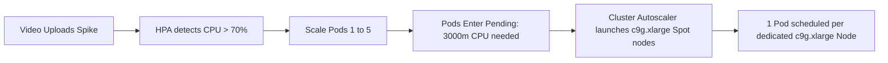

# Shumai on AWS EKS with Graviton5 Spot & Autoscaling

This directory contains a complete, production-ready Kubernetes deployment example for running Shumai on **Amazon Elastic Kubernetes Service (Amazon EKS)**, with horizontal autoscaling for compute-intensive media processing.

The example should also be straightforward to adapt to a generic Kubernetes cluster.

To demonstrate a fully self-hosted setup, it uses Garage as an S3-compatible object storage solution. However, if you're deploying on AWS, consider using **Amazon S3** instead of running your own S3-compatible storage server, as it can be significantly more cost-effective and easier to manage.

---

## Architecture Overview

```text
                                [ User / Internet ]
                                         │
                    ┌────────────────────┴────────────────────┐
                    │ (Port 80/3000)                          │ (Port 3900)
                    ▼                                         ▼
        ┌───────────────────────┐                 ┌───────────────────────┐
        │  shumai-server (ELB)  │                 │  garage-public (ELB)  │
        └───────────┬───────────┘                 └───────────┬───────────┘
                    │                                         │ Direct Browser Uploads
                    │                                         ▼ (Presigned URLs)
┌───────────────────┼─────────────────────────────────────────────────────────────────┐
│ General Workload Node (c9g.large On-Demand, ~$0.087/hr)                             │
│                   │                                                                 │
│                   ▼                                                                 │
│       ┌───────────────────────┐   Enqueue DBOS Tasks    ┌───────────────────┐       │
│       │     shumai-server     ├────────────────────────►│  shumai-postgres  │       │
│       │(SHUMAI_WORKERS=agent) │    (transcode_queue)    │  (pgvector:pg18)  │       │
│       └───────────┬───────────┘                         └─────────┬─────────┘       │
│                   │ Internal S3 Traffic                           │                 │
│                   ▼                                               │                 │
│       ┌───────────────────────┐                                   │                 │
│       │       garage-s3       │                                   │                 │
│       │    (dxflrs/garage)    │                                   │                 │
│       └───────────▲───────────┘                                   │                 │
└───────────────────┼───────────────────────────────────────────────┼─────────────────┘
                    │ Read Source / Write Proxies                   │ Poll Tasks
                    │                                               ▼
┌───────────────────┴─────────────────────────────────────────────────────────────────┐
│ Transcode Compute Pool (c9g.xlarge Graviton5 Spot, ~$0.08/hr, 1 Pod per Node)       │
│                                                                                     │
│  ┌──────────────────────────┐  ┌──────────────────────────┐  ┌────────────────────┐ │
│  │     shumai-transcode     │  │     shumai-transcode     │  │  shumai-transcode  │ │
│  │      (Worker Pod 1)      │  │      (Worker Pod 2)      │  │   (Worker Pod N)   │ │
│  └────────────┬─────────────┘  └────────────┬─────────────┘  └──────────┬─────────┘ │
│               ▼                             ▼                           ▼           │
│  ┌──────────────────────────┐  ┌──────────────────────────┐  ┌────────────────────┐ │
│  │   Node 1: c9g.xlarge     │  │   Node 2: c9g.xlarge     │  │ Node N: c9g.xlarge │ │
│  │       (Spot)             │  │       (Spot)             │  │       (Spot)       │ │
│  └──────────────────────────┘  └──────────────────────────┘  └────────────────────┘ │
│                                                                                     │
│  HPA: Scales pods 1..5 on CPU > 70% │ Cluster Autoscaler: Scales Spot nodes 1..5    │
└─────────────────────────────────────────────────────────────────────────────────────┘
```

---

## Core Design Principles

### 1. Compute Tiering: On-Demand Core & Graviton Spot Workers

Media transcoding with FFmpeg is one of the most CPU-intensive workloads in modern web applications. To ensure rock-solid stability for persistent data while minimizing transcoding costs, this deployment strictly separates system services from media encoding:

- **General System Node (`shumai-general`)**: A single 2 vCPU / 4 GiB RAM (`c9g.large` **On-Demand**) node (~$0.087/hr) hosts the Web UI, API server, PostgreSQL database, and Garage S3.
  > [!IMPORTANT]
  > **Why On-Demand for Core Services?**
  > Spot instances are subject to involuntary AWS reclamation (interruption). Running stateful services (PostgreSQL, local S3 storage) and the primary user-facing API on an On-Demand instance guarantees that the database and storage layers are never killed, evicted, or subject to abrupt downtime.

- **Dedicated Transcode Pool (`shumai-transcode-spot`)**: High-performance 4 vCPU / 8 GiB RAM Graviton Spot instances (`c9g.xlarge` primary, with `c8g.xlarge` fallback pools) dedicated exclusively to media encoding.

### 2. Task Orchestration via DBOS Transact

All video and document transcoding jobs are enqueued to `transcode_queue` inside PostgreSQL via **DBOS Transact**. Transcode workers are completely stateless and consume jobs from the queue. Each worker pod uses the Kubernetes Downward API (`POD_NAME`) to obtain a unique, collision-free executor ID.

### 3. What Happens If Transcode Spot Nodes Are Interrupted or Killed?

Because the transcode workers are completely stateless and coordinated via **DBOS Transact** against PostgreSQL on the On-Demand node:

1. **State Isolation**:
   PostgreSQL, EBS persistent volume claims, the Web UI, and S3 storage live on the On-Demand node and are **never terminated** during Spot interruptions.
2. **AWS 2-Minute Interruption Warning & Graceful Drain**:
   When AWS reclaims a Spot instance, it issues a 2-minute notice. Kubernetes drains the node and sends `SIGTERM` to the worker pod. With `terminationGracePeriodSeconds: 300`, the worker finishes any encoding step currently near completion, uploads the result to S3, and exits cleanly.
3. **Automatic Step Recovery via DBOS**:
   If an instance is terminated abruptly mid-encode, **zero data or tasks are lost**. The video source file remains safe in S3. DBOS workflow step states are durably tracked in PostgreSQL; uncompleted tasks are detected by surviving or newly launched workers and automatically re-executed from their last durable checkpoint.
4. **Spot Capacity Pool Diversification**:
   [`eks/eks-cluster.yaml`](./eks-cluster.yaml) configures `instanceTypes: [c9g.xlarge, c8g.xlarge]`. If AWS temporarily exhausts Graviton5 (`c9g.xlarge`) Spot capacity in an Availability Zone, the Auto Scaling Group immediately falls back to Graviton4 (`c8g.xlarge`) Spot capacity. All three families share the same 4 vCPU / 8 GiB RAM profile and ARM64 architecture.
5. **What If All Spot Nodes Are Killed Simultaneously?**
   - Transcode worker pods enter `Pending` state (`Insufficient cpu`).
   - All newly submitted transcode jobs queue safely inside PostgreSQL on the On-Demand node. No user uploads or jobs are dropped.
   - The **Cluster Autoscaler** detects the `Pending` pods and continuously requests new EC2 Spot instances from AWS.
   - As soon as Spot capacity becomes available (typically within 1–2 minutes), new nodes launch, pods schedule to `Running`, and workers resume draining the queue.

---

## Autoscaling Mechanics

Autoscaling operates across two coordinated layers:



1. **Horizontal Pod Autoscaler (HPA)**:
   - Configured in [`shumai-transcode-hpa.yaml`](./shumai-transcode-hpa.yaml) targeting **70% CPU utilization** of the pod's `3000m` CPU request (= 2.1 vCPUs).
   - When a video transcode starts, FFmpeg consumes ~3.5 cores, immediately exceeding 70% and prompting HPA to scale out worker pods (up to 5 replicas).
2. **1:1 Dedicated Pod-to-Node Allocation**:
   - In [`shumai-transcode.yaml`](./shumai-transcode.yaml), worker pods request `cpu: 3000m` and `memory: 4Gi` with limits at `cpu: 3900m` and `memory: 6Gi`.
   - Because a `c9g.xlarge` instance has `3920m` allocatable CPU, **strictly 1 transcode pod can fit per node**, giving FFmpeg unrestricted access to all 4 physical cores without CPU throttling.
   - Additional pods enter `Pending` state, which immediately triggers the **Kubernetes Cluster Autoscaler** to scale up the AWS Auto Scaling Group (`shumai-transcode-spot`).
3. **Graceful Scale-Down & Task Safety**:
   - **5-Minute HPA Stabilization Window** (`stabilizationWindowSeconds: 300`): Once the queue is clear and CPU drops to 0%, HPA holds replicas for 5 minutes to avoid pod thrashing if new uploads arrive.
   - **5-Minute Termination Grace Period** (`terminationGracePeriodSeconds: 300`): When Kubernetes terminates a worker, it sends `SIGTERM`. The worker stops taking new jobs, drains the active FFmpeg transcode step, uploads proxies to S3, and exits cleanly.
   - **10-Minute Node Cooldown**: Cluster Autoscaler waits for idle nodes to be unneeded for 10 minutes (`scale-down-unneeded-time=10m`) before cordoning, draining, and terminating the EC2 Spot instance.

---

## Step-by-Step Deployment Guide

### Prerequisites

- [AWS CLI](https://aws.amazon.com/cli/) installed and configured (`aws configure`).
- [`eksctl`](https://eksctl.io/) installed.
- [`kubectl`](https://kubernetes.io/docs/tasks/tools/) installed.

### Step 1: Provision the EKS Cluster

Create the cluster using the declarative [`eks/eks-cluster.yaml`](./eks-cluster.yaml) configuration:

```bash
eksctl create cluster -f eks/eks-cluster.yaml
```

This provisions:
- An EKS 1.31 control plane in a dedicated VPC across multiple AZs.
- `shumai-general`: 1x `c9g.large` On-Demand instance (labeled `workload: general`) for reliable API, database, and storage.
- `shumai-transcode-spot`: Autoscaling `c9g.xlarge` Spot instances with `c8g.xlarge` fallback pools (min: 1, max: 5, labeled `workload: transcode`).
- AWS EBS CSI Driver with IAM OIDC roles.

### Step 2: Deploy the Shumai Stack

Deploy all components with Kustomize:

```bash
kubectl apply -k eks/
```

Verify that all initial pods reach `Running` state:

```bash
kubectl get pods -n shumai -o wide
```

### Step 3: Configure Public Access & S3 Endpoint

Retrieve the external LoadBalancer hostnames created by AWS:

```bash
kubectl get svc -n shumai
```

```text
NAME             TYPE           EXTERNAL-IP                                PORT(S)
shumai-server    LoadBalancer   k8s-shumai-xxx.us-east-1.elb.amazonaws.com 80:31234/TCP,3000:31235/TCP
garage-public    LoadBalancer   k8s-garage-xxx.us-east-1.elb.amazonaws.com 3900:31236/TCP
```

#### Option A: Quick Testing (Automated 1-Liner)
Inject the public Garage ELB hostname into `shumai-server`:

```bash
GARAGE_ELB=$(kubectl get svc garage-public -n shumai -o jsonpath='{.status.loadBalancer.ingress[0].hostname}')
kubectl set env deployment/shumai-server -n shumai AWS_PUBLIC_ENDPOINT_URL_S3="http://${GARAGE_ELB}:3900"
```

#### Option B: Production with Custom Domains
In production, point DNS records (e.g. Route 53) to your load balancers:
- Web App: `https://shumai.mycompany.com`
- S3 Storage: `https://s3.mycompany.com`

Set `AWS_PUBLIC_ENDPOINT_URL_S3: https://s3.mycompany.com` in [`eks/config.yaml`](./config.yaml) and apply once.

#### Option C: Native Amazon S3
If using real AWS S3, set `STORAGE_BACKEND: s3`, provide `S3_BUCKET`, and omit `AWS_PUBLIC_ENDPOINT_URL_S3` (native AWS S3 endpoints resolve globally).

### Step 4: Deploy Kubernetes Cluster Autoscaler

Deploy the official Cluster Autoscaler to enable automated node provisioning:

```bash
curl -s https://raw.githubusercontent.com/kubernetes/autoscaler/master/cluster-autoscaler/cloudprovider/aws/examples/cluster-autoscaler-autodiscover.yaml \
  | sed 's/<YOUR CLUSTER NAME>/shumai-eks/g' \
  | kubectl apply -f -

# Pin autoscaler to the general workload node
kubectl patch deployment cluster-autoscaler -n kube-system -p '{"spec":{"template":{"spec":{"nodeSelector":{"workload":"general"}}}}}'
```

### Step 5: Test Horizontal Autoscaling

1. Open `http://<shumai-server-elb>` in your browser and log in with your credentials.
2. Upload a batch of 10–20 video files simultaneously.
3. Watch the workers scale up horizontally:
   ```bash
   kubectl get hpa -n shumai -w
   kubectl get pods -n shumai -l app=shumai-transcode -o wide
   kubectl get nodes -L node.kubernetes.io/instance-type,workload
   ```
4. Observe that each worker consumes ~3 vCPUs on its dedicated `c9g.xlarge` instance.
5. Once all jobs complete, observe HPA scaling back down to 1 pod and Cluster Autoscaler terminating idle EC2 Spot instances.

### Step 6: Cluster Teardown & Cost Cleanup

When you are finished testing, delete all resources to prevent ongoing cloud charges:

```bash
# 1. Delete Kubernetes namespace to release ELB load balancers and EBS volumes
kubectl delete namespace shumai

# 2. Delete the EKS cluster and CloudFormation stacks
eksctl delete cluster -f eks/eks-cluster.yaml --wait
```
